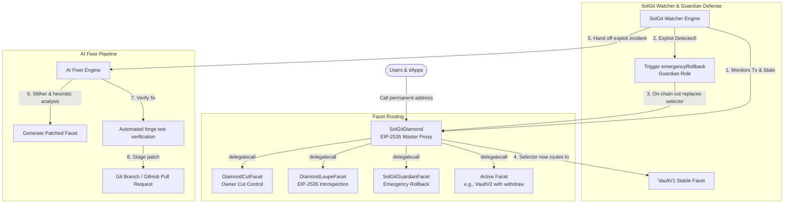

# SolGit: Git-Style Smart Contract Platform & Self-Healing Defense

> **A GitHub-like platform for Solidity smart contracts** with permanent contract addresses powered by **EIP-2535 Diamond Proxies**, automated **Guardian-role function rollbacks**, and an **AI Fixer** that patches compromised code.

Built natively for the **MST Blockchain** (Chain ID: `54635`, MST Coral Testnet, ~3s block time, EVM-compatible).

---

## Live Deployments: MST Coral Testnet

SolGit is 100% connected directly to the **MST Coral Testnet** with zero mock layers, fake local RPCs, or artificial bridges. All contracts are verified and operational on-chain.

| Network Parameter | Value | Explorer / RPC Link |
| :--- | :--- | :--- |
| **Network Name** | MST Coral Testnet | [MST Blockchain](https://mstblockchain.com) |
| **Chain ID** | `54635` | Hex: `0xd56b` |
| **RPC Endpoint** | `https://coralrpc.mstblockchain.com` | Live EVM JSON-RPC |
| **Block Explorer** | `https://coral.mstscan.com` | Live Explorer |
| **Native Currency** | `MST` | 18 Decimals |

### Deployed Platform Contracts

| Contract / Facet | On-Chain Address | Description |
| :--- | :--- | :--- |
| **SolGit Master Diamond Proxy** | [`0x56B05b503A117840A73740a1b8744B12732e44e5`](https://coral.mstscan.com/address/0x56B05b503A117840A73740a1b8744B12732e44e5) | Permanent entrypoint for all dApps and user transactions (EIP-2535) |
| **VersionRegistry** | [`0x88FE3bAF29B6f5A3D8343B959dfB3516E2DA6B27`](https://coral.mstscan.com/address/0x88FE3bAF29B6f5A3D8343B959dfB3516E2DA6B27) | Immutable on-chain ledger of commit hashes, selectors, and version states |
| **SolGitGuardianFacet** | [`0xD3dcC7D6cC2e1f0F5A31f8Ba94c42F1c2F72d771`](https://coral.mstscan.com/address/0xD3dcC7D6cC2e1f0F5A31f8Ba94c42F1c2F72d771) | Automated emergency rollback facet restricted to registered stable facets |
| **DiamondCutFacet** | [`0x259830976F39396f7754B1229F61D295C61dA8De`](https://coral.mstscan.com/address/0x259830976F39396f7754B1229F61D295C61dA8De) | Owner facet management facet (`diamondCut`) |
| **DiamondLoupeFacet** | [`0xA71a0F3fcA64d9a951996Fc44eA5aF3A21E83204`](https://coral.mstscan.com/address/0xA71a0F3fcA64d9a951996Fc44eA5aF3A21E83204) | EIP-2535 standard loupe introspection (`facetAddresses`, `facetFunctionSelectors`) |
| **OwnershipFacet** | [`0xCc3587C0e8eefb3dE27d0FfBD1A496af1821Eed1`](https://coral.mstscan.com/address/0xCc3587C0e8eefb3dE27d0FfBD1A496af1821Eed1) | ERC-173 ownership management facet |
| **VaultV1 Facet (Stable)** | [`0x463DC23a3E649Cf3FF54762F6588f1D71C207c01`](https://coral.mstscan.com/address/0x463DC23a3E649Cf3FF54762F6588f1D71C207c01) | Certified secure Vault implementation (initial baseline) |
| **VaultV2 Facet (Vulnerable Demo)** | [`0x91697d3d38C493F76745dcC72FBe248Fc14fBCB7`](https://coral.mstscan.com/address/0x91697d3d38C493F76745dcC72FBe248Fc14fBCB7) | Vulnerable facet used to demonstrate Guardian instant rollback |
| **VaultV2Fixed Facet (Patched)** | [`0xb1C889707d426A7A386870A03bc70d1b06975990`](https://coral.mstscan.com/address/0xb1C889707d426A7A386870A03bc70d1b06975990) | Secure replacement facet synthesized by the AI Fixer |

---

## The Vision: What SolGit Solves

Deploying smart contracts today is high-risk:
1. **Broken Addresses**: When a contract is upgraded or re-deployed to patch a bug, dApps, frontends, integrations, and liquidity pools must change their contract address or rely on rigid proxy patterns.
2. **Exploits Strike in Seconds**: By the time a developer wakes up to an attack notification, protocols are already drained.
3. **All-or-Nothing Freezes**: Traditional emergency pauses freeze the entire protocol, breaking user operations and causing panic.

**SolGit transforms smart contract management:**
* **Upload Like GitHub**: Developers upload their smart contracts (facets and functions) and manage versions per function selector.
* **Permanent Address (EIP-2535 Diamond)**: SolGit deploys the contract behind an EIP-2535 Diamond Proxy. Your dApp connects to one permanent address that never changes.
* **Automated Guardian Rollback**: When an attack is detected on a specific function, our off-chain Watcher instantly executes an on-chain `emergencyRollback` using the Guardian role. **Only the attacked function selector is reverted** to its last known stable facet version. Connected dApps experience zero disruption!
* **Self-Healing AI Fixer**: Once the contract is safe, the AI Fixer analyzes the exploit trace and vulnerable code, generates a secure patch, runs automated `forge test` verification, and opens a Pull Request with the hotfix ready for deployment.

---

## Direct On-Chain Architecture (Zero Artificial Bridges)

SolGit eliminates all off-chain proxies, simulated bridges, and synthetic shims. Every component communicates directly with the EVM state on MST Coral Testnet:

```
┌────────────────────────────────────────────────────────────────────────────────────────┐
│                               MST Coral Testnet (EVM)                                  │
│                                                                                        │
│   ┌────────────────────────────────────────────────────────────────────────────────┐   │
│   │               SolGit Master Diamond Proxy (0x56B05b...44e5)                    │   │
│   │                                                                                │   │
│   │  Selector Table:                                                               │   │
│   │  ├─ deposit()       ──> VaultV1 (0x463D...7c01)                                │   │
│   │  ├─ withdraw()      ──> VaultV1 (0x463D...7c01) [Restored by Guardian]         │   │
│   │  ├─ emergencyRollback() ──> GuardianFacet (0xD3dc...d771)                      │   │
│   │  └─ facetAddresses()──> LoupeFacet (0xA71a...3204)                             │   │
│   └───────────────▲───────────────────────────────────▲────────────────────────────┘   │
│                   │ delegatecall                      │ delegatecall                   │
│   ┌───────────────┴───────────────┐   ┌───────────────┴────────────────────────────┐   │
│   │   VersionRegistry Contract    │   │           Storage Layout                   │   │
│   │     (0x88FE3b...6B27)         │   │   keccak256("diamond.standard.diamond...") │   │
│   └───────────────────────────────┘   └────────────────────────────────────────────┘   │
└───────────────────▲───────────────────────────────────▲────────────────────────────────┘
                    │                                   │
      RPC Calls     │ Direct JSON-RPC                   │ Direct JSON-RPC
      (eth_call,    │ (https://coralrpc.mstblockchain)  │ (eth_sendRawTransaction)
       eth_getLogs) │                                   │
┌───────────────────┴───────────────┐   ┌───────────────┴────────────────────────────┐
│      SolGit Web Dashboard         │   │            SolGit Sentinel Watcher         │
│   • Next.js 16 App Router         │   │   • Subscribes to live Coral blocks        │
│   • Direct Viem publicClient      │   │   • Inspects transaction traces            │
│   • Reads Loupe, Reg & Balances   │   │   • Executes Guardian emergencyRollback    │
│   • Deploys via Gasless Relayer   │   │   • Triggers AI Fixer sandbox synthesis    │
└───────────────────────────────────┘   └────────────────────────────────────────────┘
                    ▲                                   ▲
                    │                                   │
┌───────────────────┴───────────────┐   ┌───────────────┴────────────────────────────┐
│      Coral Vault Demo dApp        │   │             Developer CLI                  │
│   • Vite / React / Wagmi          │   │   • solgit init, push, promote, revert     │
│   • User deposits & withdrawals   │   │   • Manages diamond selectors directly     │
│   • Permanent Diamond connection  │   │   • Verifies commit hashes on Coral        │
└───────────────────────────────────┘   └────────────────────────────────────────────┘
```



---

## Key Components

### 1. SolGit Diamond (`src/core/SolGitDiamond.sol` & `LibDiamond.sol`)
* **Standard EIP-2535 Diamond Proxy**: Manages per-function routing through namespaced diamond storage (`keccak256("diamond.standard.diamond.storage")`).
* **Owner Sovereignty**: Contract owner has full, unrestricted `diamondCut` authority.
* **The Guardian Invariant**: The SolGit Watcher holds the `Guardian` role, which is **strictly constrained** to `emergencyRollback(bytes4 selector, address targetFacet)`. The Guardian can **only** revert a selector to an address verified in `isRegisteredStableFacet`. The Guardian *can never inject arbitrary code or rug-pull the contract*.

### 2. Version Registry (`src/core/VersionRegistry.sol`)
* Tracks per-selector version lifecycles (`Active`, `Stable`, `Quarantined`).
* Records commit hashes, facet code hashes, and deployment timestamps directly on MST Coral.

### 3. SolGit Watcher (`watcher/`)
* Off-chain guardian service that monitors diamond contract transactions and state anomalies (reentrancy traces, balance drain velocity, and exploit patterns).
* Upon detecting an exploit, signs and submits `emergencyRollback` to the Diamond proxy within seconds.

### 4. AI Fixer (`watcher/src/fixer.ts`)
* Analyzes root-cause bugs (e.g. unchecked arithmetic, missing Checks-Effects-Interactions, reentrancy).
* Produces clean patched Solidity code (`VaultV2Fixed.sol`).
* Automatically runs Foundry tests (`forge test`) in a sandbox to verify the patch before staging a Git branch and Pull Request.

### 5. Developer CLI (`cli/`)
* `solgit init --diamond <address> --registry <address>`: Initialize project configuration.
* `solgit status`: Inspect current version, active facets, and stability status across all selectors.
* `solgit push <selector> <implementation>`: Push a new facet version.
* `solgit promote <selector> <version>`: Mark a tested version as Stable.
* `solgit revert <selector> <version>`: Manually roll back a selector.

---

## Monorepo Layout

```
SolGit/
├── src/                          # Smart Contracts (Foundry)
│   ├── core/
│   │   ├── SolGitDiamond.sol     # EIP-2535 Master Diamond Proxy
│   │   └── VersionRegistry.sol   # Per-selector version & commit history
│   ├── facets/
│   │   ├── DiamondCutFacet.sol   # Owner diamondCut management
│   │   ├── DiamondLoupeFacet.sol # EIP-2535 introspection
│   │   ├── OwnershipFacet.sol    # ERC-173 ownership
│   │   ├── SolGitGuardianFacet.sol # Emergency rollback facet (Guardian role)
│   │   ├── VaultV1.sol           # Safe initial stable vault facet
│   │   ├── VaultV2.sol           # Vulnerable facet (for demo/testing)
│   │   └── VaultV2Fixed.sol      # Patched facet generated by AI Fixer
│   ├── libraries/
│   │   ├── LibDiamond.sol        # EIP-2535 Diamond storage & rollback logic
│   │   └── SolGitErrors.sol      # Custom error registry
│   └── storage/
│       └── VaultStorage.sol      # Namespaced diamond storage layout
├── test/                         # Foundry Test Suites (37 tests, 100% passing)
│   ├── SolGitDiamond.t.sol       # Diamond deployment, loupe, and delegation tests (5 tests)
│   ├── SolGitGuardian.t.sol      # Guardian rollback & exploit prevention tests (3 tests)
│   ├── VaultFacet.t.sol          # Vault business logic & invariant tests (7 tests)
│   ├── VaultV2Fixed.t.sol        # Verified patched facet tests (4 tests)
│   └── VersionRegistry.t.sol     # Commit & version promotion tests (18 tests)
├── dashboard/                    # Web Platform & Visualizer (Next.js 16 App Router)
├── demo-dapp/                    # Live Demo dApp (Vite + React + Wagmi + Viem)
├── watcher/                      # Off-chain Sentinel Watcher & AI Fixer Engine (TypeScript)
├── cli/                          # Developer CLI (TypeScript)
├── script/Deploy.s.sol           # MST Coral deployment script
└── demo.sh                       # End-to-end verification demo script
```

---

## Verification & Testing

Every layer of the SolGit monorepo is covered by automated verification suites:

### 1. Smart Contract Test Suite (Foundry)
```bash
forge test
```
**Result**: 5 test suites, **37 tests passed, 0 failed, 0 skipped**.

### 2. Dashboard Unit & Integration Suite
```bash
npm --prefix dashboard test
```
**Result**: **16 tests passed, 0 failed**, testing identicon grids, wei formatting, Coral RPC client configuration, relayer deployment validation, event log extraction, and chain definitions.

### 3. Dashboard Linter & Production Build
```bash
npm --prefix dashboard run lint
npm --prefix dashboard run build
```
**Result**: 0 ESLint errors/warnings, Turbopack production compilation successful.

### 4. Demo dApp Production Build
```bash
npm --prefix demo-dapp run build
```
**Result**: TypeScript type check passed, Vite production build successful.

### 5. Sentinel Watcher & CLI Builds
```bash
npm --prefix watcher run build
npm --prefix cli run build
```
**Result**: TypeScript compilation successful.

---

## Vercel Deployment Guide

The SolGit Web Dashboard (`dashboard/`) is a Next.js 16 App Router application configured for one-click deployment on Vercel.

### Prerequisites
- Node.js 20+ installed
- [Vercel CLI](https://vercel.com/docs/cli) installed: `npm i -g vercel`
- A Vercel account

---

### Step 1: Environment Variables

Configure the following environment variables in your Vercel project settings or CLI prompts:

| Variable Name | Required | Default / Value | Description |
| :--- | :---: | :--- | :--- |
| `NEXT_PUBLIC_MST_CHAIN_ID` | **Yes** | `54635` | Chain ID for MST Coral Testnet |
| `NEXT_PUBLIC_MST_RPC_URL` | **Yes** | `https://coralrpc.mstblockchain.com` | Official EVM JSON-RPC endpoint |
| `NEXT_PUBLIC_MST_EXPLORER_URL` | **Yes** | `https://coral.mstscan.com` | MST Coral Testnet block explorer |
| `PRIVATE_KEY` | Optional | `0x...` | Relayer private key for gasless contract deployments |
| `NEXT_PUBLIC_SUPABASE_URL` | Optional | `https://your-project.supabase.co` | Supabase URL for multi-user state synchronization |
| `NEXT_PUBLIC_SUPABASE_ANON_KEY` | Optional | `your_anon_key` | Supabase client anon key |
| `SUPABASE_SERVICE_ROLE_KEY` | Optional | `your_service_role_key` | Supabase server service key |
| `GROQ_API_KEY` | Optional | `gsk_...` | Groq API key for AI Fixer patch synthesis |

---

### Step 2: Deploying via Vercel CLI (Recommended)

#### Option A: Deploy from Project Directory
```bash
# Navigate to the dashboard directory
cd dashboard

# Log in to Vercel (if not already logged in)
vercel login

# Deploy a Preview build
vercel

# Deploy directly to Production
vercel --prod
```

#### Option B: Deploy from Monorepo Root
```bash
vercel --cwd dashboard --prod
```

During CLI setup, Vercel will prompt:
- **Set up and deploy?**: `y`
- **Which scope?**: Select your team or personal account
- **Link to existing project?**: `N` (for new project) or `y` (to link existing)
- **Project name?**: `solgit-dashboard`
- **In which directory is your code located?**: `./` (when run from `dashboard/`) or `./dashboard` (from root)

---

### Step 3: Setting Environment Variables in Vercel

You can add environment variables via the Vercel CLI or Web Console:

#### Using CLI:
```bash
cd dashboard
vercel env add NEXT_PUBLIC_MST_CHAIN_ID production
# Enter value: 54635

vercel env add NEXT_PUBLIC_MST_RPC_URL production
# Enter value: https://coralrpc.mstblockchain.com

vercel env add NEXT_PUBLIC_MST_EXPLORER_URL production
# Enter value: https://coral.mstscan.com

vercel env add PRIVATE_KEY production
# Enter your funded Coral Testnet private key
```

#### Using Web Console:
1. Open your project on [vercel.com](https://vercel.com).
2. Go to **Settings** > **Environment Variables**.
3. Add the key-value pairs listed in the table above.
4. Redeploy by pushing to `main` or running `vercel --prod`.

---

### Step 4: Verify Deployment

Once deployed, verify that the dashboard connects to MST Coral Testnet:
1. Open the deployment URL (e.g., `https://solgit-dashboard.vercel.app`).
2. Confirm the network indicator in the header displays **MST Coral Testnet (54635)** with a green active status.
3. Check the **Contracts** section to verify the SolGit Master Diamond (`0x56B05b503A117840A73740a1b8744B12732e44e5`) loads live selector statuses and vault balance.
4. Test the API endpoint:
   ```bash
   curl -s https://your-deployment.vercel.app/api/repos | jq .
   ```

---

## Running the End-to-End Self-Healing Demo Locally

```bash
./demo.sh
```

This automated demo executes:
1. **Foundry Test Verification**: Compiles and tests all 37 contract unit tests.
2. **TypeScript Builds**: Builds Sentinel Watcher and Developer CLI.
3. **Attack Simulation & Detection**: Executes simulated attack against `withdraw()` on `VaultV2`.
4. **Guardian Instant Rollback**: Watcher triggers `emergencyRollback` on-chain, restoring `withdraw()` to `VaultV1` within seconds without modifying the contract address.
5. **AI Fixer Sandbox**: Generates secure `VaultV2Fixed.sol`, verifies the patch via `forge test`, and creates a Git pull request with the hotfix.

---

## License

MIT License. Designed and built for the MST Blockchain Ecosystem.
